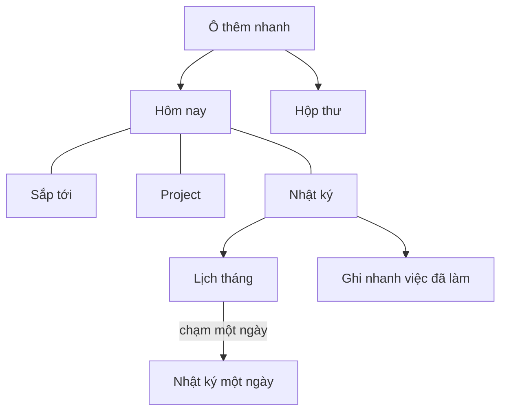
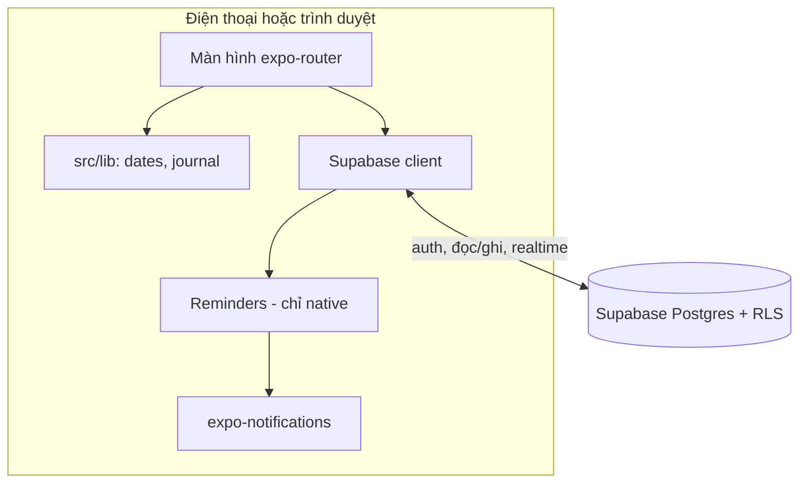
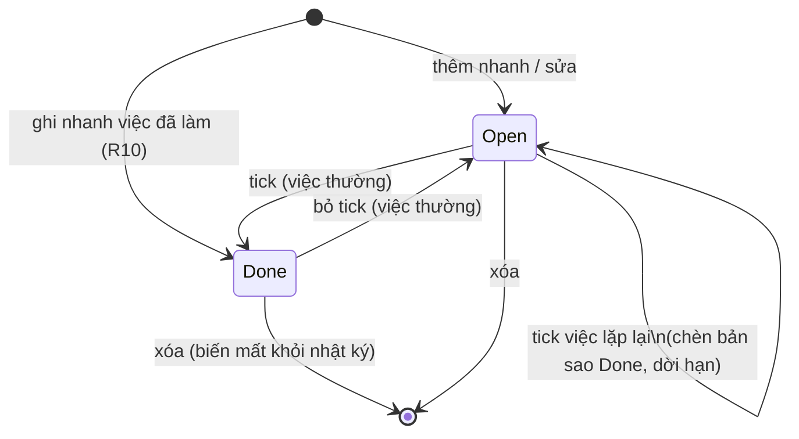

# Task App with Daily Journal - Plan

## Goal Capsule

- **Objective:** Một người dùng ghi được mọi việc cần làm vào một chỗ, mở trên điện thoại hay trình duyệt đều thấy cùng dữ liệu, và xem lại được bất kỳ ngày nào mình đã làm xong những gì.
- **Means:** Một codebase Expo chạy cả mobile và web (KTD1), Supabase giữ tài khoản và dữ liệu (KTD2).
- **Product authority:** Chủ app (người dùng duy nhất). Mọi thay đổi phạm vi do người này quyết. Product Contract thắng về hành vi; KTD thắng về cơ chế.
- **Execution profile:** Làm theo thứ tự U1, U2, U3, U4, U8, U5, U6, U7. U4 làm test-first. Giao diện làm qua skill `/evon:ui-ux` (KTD11); skill này dừng chờ chủ app duyệt brief và chọn wireframe, nên U8, U5 và U6 không chạy một mạch được. Các màn hình kiểm tra bằng tay trên web và trên điện thoại.
- **Stop conditions:** Dừng và báo lại nếu đăng nhập Supabase hoặc realtime không chạy được trên bản web của Expo SDK 58, hoặc nếu một yêu cầu R buộc phải ghi offline.
- **Who finishes:** `ce-work` làm và tự kiểm tra; chủ app chạy thử trên điện thoại thật trước khi coi là xong.
- **Open blockers:** Không có. Cần một project Supabase và hai biến môi trường trước khi chạy U3 (xem Risks & Dependencies).

---

## Product Contract

Product Contract preservation: changed: R12 — người dùng chọn đếm việc trễ theo hạn chót hiện tại (Key Decision tương ứng); phần còn lại không đổi. Các câu hỏi "Deferred to Planning" đã được trả lời và chuyển vào KTD1, KTD2, KTD4 và Scope Boundaries.

### Summary

App quản lý việc cá nhân chạy trên mobile và web, đồng bộ qua một tài khoản. Phần lõi giống Todoist: thêm nhanh, hạn chót, ưu tiên, project, việc lặp lại, nhắc việc. Thêm màn Nhật ký để xem lại từng ngày đã làm xong gì, kể cả những việc được ghi nhanh sau khi làm.

### Problem Frame

Hiện người dùng chưa dùng công cụ quản lý việc nào. Việc cần làm nằm trong đầu nên dễ sót, và cuối ngày không có cách nào biết mình đã làm được gì. Người dùng muốn tự nhìn lại tiến độ của bản thân, không phải báo cáo cho ai. Vì chưa có thói quen ghi việc, nhiều việc sẽ được làm mà chưa từng nằm trong danh sách; nếu chỉ đếm việc đã tick, bức tranh cuối ngày sẽ thiếu đúng những việc đó.

### Key Decisions

- **Nhật ký phục vụ tự xem lại, không phải gửi người khác.** Báo cáo thiên về lịch sử và thống kê, không cần văn bản soạn sẵn để dán vào chat. Governs R11, R12, R13. (session-settled: user-directed — chosen over gửi sếp/team và chấm công theo giờ: người dùng chọn mục đích tự xem lại.)
- **Nhật ký = việc đã tick xong + việc ghi nhanh sau khi làm.** Ghi nhanh lấp chỗ trống cho việc phát sinh ngoài danh sách. Governs R10, R11. (session-settled: user-approved — chosen over chỉ liệt kê việc đã tick và đếm thời gian theo việc: báo cáo chỉ tính việc đã tick sẽ thiếu việc phát sinh, còn đếm giờ không hợp mục đích tự xem lại.)
- **Bản đầu cần có mạng mới thêm hoặc sửa được.** Chọn để giữ bản đầu nhỏ; ghi việc khi mất mạng là thay đổi đắt nếu thêm sau. Governs R2. (session-settled: user-approved — chosen over ghi offline rồi đồng bộ sau: người dùng đã thấy điểm này là chỗ đắt khi đổi ý và vẫn đồng ý.)
- **Chỉ một người dùng.** Không có chia sẻ hay cộng tác, nên không cần quyền hay phân vai.
- **Số việc trễ chỉ tính theo hạn chót hiện tại, không lưu lịch sử hạn.** Một việc lặp lại bỏ lỡ nhiều ngày chỉ bị tính trễ ở ngày hạn đang lưu, và việc bị dời hạn không còn bị tính trễ ở ngày cũ. Governs R12. (session-settled: user-directed — chosen over lưu từng ngày bị lỡ và từng lần dời hạn: giữ bản đầu nhỏ, thống kê dời hạn đã để làm sau.)

### Requirements

**Tài khoản và đồng bộ**

- R1. Người dùng đăng nhập cùng một tài khoản trên app mobile và trên web, và cả hai thấy cùng một bộ dữ liệu.
- R2. Thêm hoặc sửa dữ liệu cần có mạng; khi mất mạng, app báo rõ thao tác chưa lưu được thay vì âm thầm mất dữ liệu.

**Quản lý việc**

- R3. Ô thêm việc luôn có sẵn trên các màn danh sách; gõ tiêu đề rồi Enter là lưu, không bắt buộc điền gì thêm.
- R4. Mỗi việc có tiêu đề, ghi chú tùy chọn, hạn chót tùy chọn (ngày, có thể kèm giờ), một trong 4 mức ưu tiên, và tối đa một project.
- R5. Người dùng tạo, đổi tên và xóa project; việc không thuộc project nào nằm trong Hộp thư.
- R6. Việc lặp lại hỗ trợ hằng ngày, hằng tuần (chọn thứ), hằng tháng và mỗi N ngày; tick xong một lần thì hạn chót chuyển sang lần kế tiếp.
- R7. Việc có giờ hạn chót gửi nhắc nhở đúng giờ đó trên điện thoại.
- R8. Có các màn Hôm nay (đến hạn hôm nay và quá hạn), Sắp tới (7 ngày tới, nhóm theo ngày), Hộp thư, và màn riêng từng project.
- R9. Người dùng tick xong, bỏ tick, sửa và xóa việc.

**Nhật ký ngày**

- R10. Người dùng ghi nhanh một việc đã làm mà không cần tạo việc trước; mục đó vào thẳng nhật ký ở trạng thái đã xong, mặc định là hôm nay và có thể chọn ngày khác.
- R11. Màn Nhật ký cho chọn một ngày bất kỳ và liệt kê mọi việc đã xong trong ngày đó, gồm cả mục ghi nhanh, nhóm theo project.
- R12. Mỗi ngày trong nhật ký hiện số việc đã xong và số việc đến hạn hôm đó nhưng không được làm xong trong ngày đó, tính theo hạn chót hiện đang lưu của mỗi việc.
- R13. Lịch tháng hiện số việc đã xong của mỗi ngày; chạm vào một ngày mở nhật ký của ngày đó.

**Lịch sử**

- R14. Việc đã xong không bao giờ tự bị xóa hay ẩn khỏi nhật ký; chỉ khi người dùng tự xóa thì việc đó mới mất khỏi nhật ký.
- R15. Mỗi lần tick xong một việc lặp lại là một mục riêng trong nhật ký của ngày được tick.
- R16. Một việc thuộc về ngày theo giờ địa phương trên thiết bị tại thời điểm tick xong.



### Acceptance Examples

- AE1. Việc lặp lại vào nhật ký mỗi lần tick
  - **Covers R6, R15.**
  - **Given:** "Tập thể dục" lặp hằng ngày.
  - **When:** người dùng tick xong vào thứ Hai và thứ Ba.
  - **Then:** nhật ký thứ Hai và thứ Ba mỗi ngày có một mục "Tập thể dục", và việc đó hiện hạn chót thứ Tư.
- AE2. Tick sau nửa đêm
  - **Covers R16.**
  - **Given:** một việc đến hạn ngày 3.
  - **When:** người dùng tick xong lúc 00:30 ngày 4.
  - **Then:** việc nằm trong nhật ký ngày 4, và ngày 3 tính nó là đến hạn nhưng không xong trong ngày.
- AE3. Xóa việc đã xong
  - **Covers R14.**
  - **Given:** nhật ký hôm qua có 5 việc đã xong.
  - **When:** người dùng xóa một trong số đó.
  - **Then:** nhật ký hôm qua còn 4 việc, và lịch tháng hiện 4 cho ngày đó.
- AE4. Bỏ tick
  - **Covers R9, R11.**
  - **Given:** một việc đã tick xong hôm nay.
  - **When:** người dùng bỏ tick.
  - **Then:** việc biến mất khỏi nhật ký hôm nay và quay lại danh sách việc cần làm.
- AE5. Mất mạng khi thêm việc
  - **Covers R2.**
  - **Given:** điện thoại mất mạng.
  - **When:** người dùng gõ một việc mới rồi Enter.
  - **Then:** app báo việc chưa được lưu và giữ nội dung đã gõ để người dùng thử lại.

### Scope Boundaries

**Để làm sau**

- AI tóm tắt ngày, báo cáo tuần hoặc tháng dạng văn bản.
- Ghi và sửa việc khi mất mạng rồi đồng bộ sau.
- Gõ ngôn ngữ tự nhiên để đặt hạn chót ("họp 3h chiều mai").
- Nhãn (label), việc con, bộ lọc tùy chỉnh.
- Đếm thời gian theo việc.
- Thống kê việc bị dời hạn nhiều lần.
- Widget màn hình chính.
- Nhắc việc trên web bằng thông báo trình duyệt.

**Không thuộc sản phẩm này**

- Chia sẻ, giao việc, bình luận, cộng tác nhiều người.
- Chế độ Kanban và file đính kèm.

**Đã cân nhắc, không làm**

- Đăng nhập bằng Google hay Apple: email và mật khẩu đủ cho một người dùng; thêm khi gõ mật khẩu trên điện thoại trở nên phiền.
- Hoàn tác lùi hạn chót khi bỏ tick một lần hoàn thành của việc lặp lại (KTD5): việc gốc vẫn nằm trong danh sách nên không mất gì; làm khi người dùng thấy hạn bị nhảy sai.

### Sources

- `package.json` của project `family-hub` cùng thư mục cha (cùng tác giả): Expo SDK 58, `expo-router`, `expo-notifications`, Supabase. Người dùng đã quen stack này.
- Repo này hiện mới là bộ khung Expo trống (`App.tsx`, `index.ts`, `app.json`), chưa có tính năng nào.

---

## Planning Contract

### Key Technical Decisions

- KTD1. **Một codebase Expo SDK 58 + `expo-router`, build ra iOS, Android và web (react-native-web).** Mỗi màn hình chỉ viết một lần; đổi lại web trông giống app điện thoại. Governs R1. (session-settled: user-approved — chosen over web Next.js riêng: một chỗ làm mọi màn hình, cùng stack với `family-hub`.)
- KTD2. **Supabase: đăng nhập email + mật khẩu, Postgres với row-level security `user_id = auth.uid()` trên mọi bảng, realtime để danh sách tự cập nhật giữa các máy.** Cách đọc dữ liệu theo mẫu `useRows` trong `family-hub/src/lib/supabase.ts`. Governs R1, R2. (session-settled: user-approved — chosen over lưu cục bộ trên máy: R1 cần cùng dữ liệu trên nhiều thiết bị.)
- KTD3. **Một bảng `tasks` giữ cả việc chưa xong lẫn mục nhật ký.** Một mục nhật ký là một dòng có `completed_at`. Ghi nhanh (R10) là chèn một dòng đã có sẵn `completed_at`. Nhờ vậy nhật ký, lịch tháng và danh sách việc dùng chung một nguồn, không phải đồng bộ hai bảng.
- KTD4. **Lưu cả `completed_at` (timestamptz) lẫn `completed_day` (date), với `completed_day` tính trên thiết bị theo giờ địa phương lúc tick.** Ngày của một mục nhật ký được "đóng băng" lúc tick, nên đổi múi giờ về sau không làm mục đó nhảy sang ngày khác. Cách này trả lời câu hỏi múi giờ của R16.
- KTD5. **Tick một việc lặp lại sẽ chèn một bản sao đã xong (giữ `due_date` của lần đó, `repeat` trống, `recurring_copy = true`) rồi dời `due_date` của việc gốc sang lần kế tiếp.** Hai thao tác này nằm trong một hàm SQL `complete_recurring` (security invoker, nên RLS vẫn áp dụng), gọi qua `supabase.rpc`, với hạn kế tiếp tính trên máy bằng U4. Nếu mất mạng giữa chừng thì cả hai cùng thất bại, nên tick lại không sinh mục nhật ký trùng (R15). Mỗi lần tick là một dòng nhật ký riêng (R15), còn việc gốc ở lại danh sách. Bỏ tick: dòng có `recurring_copy = true` thì bị xóa (cờ này không phụ thuộc việc gốc còn hay đã bị xóa), không lùi hạn của việc gốc (xem Scope Boundaries); mọi dòng khác thì xóa `completed_at` và `completed_day`.
- KTD6. **Lần kế tiếp = lần lặp đầu tiên sau `max(due_date, hôm nay)`.** Nhờ vậy, tick một việc hằng ngày đang quá hạn sẽ cho hạn mới là ngày mai, không phải một ngày vẫn còn ở quá khứ. Tick sớm một việc hằng tuần thì nhảy sang tuần sau của hạn hiện tại. Việc hằng tháng lưu ngày gốc trong `monthly:<ngày>`; mỗi lần tính lại từ ngày gốc và chỉ lùi về ngày cuối tháng ở những tháng ngắn hơn, nên việc ngày 31 không bị kẹt mãi ở ngày 28.
- KTD7. **Báo lỗi và hỏi xác nhận đều đi qua `notify.ts`, chạy được cả native lẫn web.** `Alert.alert` của react-native-web không hiện gì, nên cả `ok()` lẫn `confirmDelete` của `family-hub` đều không dùng nguyên được ở đây: trên web, nút xóa sẽ không bao giờ xóa. `notify.ts` có hàm báo lỗi (`window.alert` trên web) và hàm hỏi xác nhận (`window.confirm` trên web, `Alert` có nút trên native). Ô thêm nhanh chỉ xóa nội dung sau khi lưu thành công (AE5). Governs R2.
- KTD8. **Nhắc việc là thông báo cục bộ của `expo-notifications`, lên lịch lại toàn bộ mỗi khi danh sách việc thay đổi, và tắt hẳn khi chạy trên web.** Theo mẫu `family-hub/src/lib/reminders.ts`, kể cả hàng đợi chạy tuần tự. Việc lặp lại chỉ đặt nhắc cho lần kế tiếp. Governs R7.
- KTD9. **Logic thuần (ngày địa phương, lần lặp kế tiếp, gom nhật ký, đếm việc trễ) nằm trong `src/lib/` và có một file kiểm tra chạy thẳng bằng `node`.** Cùng cách `family-hub/src/lib/lunar.check.ts`; Node 22.20 chạy được TypeScript mà không cần build. Các file mà file kiểm tra import phải import nhau bằng đường dẫn tương đối có đuôi `.ts`, không dùng alias `@/`, vì node không hiểu alias. Không thêm framework test giao diện.
- KTD10. **Ngày, giờ và kiểu lặp nhập bằng ô chữ và nút chọn, không dùng date picker gốc của hệ điều hành.** Ngày gõ dạng `DD/MM` hoặc `DD/MM/YYYY`, theo `parseDate` của `family-hub/src/lib/dates.ts`; giờ gõ `HH:MM`. Ưu tiên, project và kiểu lặp chọn bằng nút; với hằng tuần thì chọn các thứ, với mỗi N ngày thì gõ N. Mỗi trường đều có nút xóa. Cách này chạy giống nhau trên web và điện thoại, và không thêm thư viện. Governs R4, R6.
- KTD11. **Giao diện thiết kế bằng skill `/evon:ui-ux` (plugin evondevKit): dựng design system trước, rồi wireframe cho các màn chính.** Chủ app yêu cầu. Skill này viết cho web (CSS, Tailwind), còn app dùng `StyleSheet` của React Native, nên lấy từ skill phần token (màu, khoảng cách, cỡ chữ, bo góc), bố cục và trạng thái của từng màn, rồi chuyển token thành hằng số trong `src/constants/theme.ts`. Không thêm Tailwind hay NativeWind. Skill được đo và soi trên bản web (`npx expo start --web`), vì nó cần một trang chạy trên trình duyệt. Mỗi brief gửi cho skill dẫn Todoist và TickTick làm tham khảo về bố cục và cách thao tác, theo chủ app yêu cầu. Mỗi brief cũng nói rõ: app ưu tiên điện thoại, điều hướng bằng thanh tab dưới với năm tab (Hôm nay, Sắp tới, Hộp thư, Project, Nhật ký); web ở 1280px giữ nguyên thanh tab đó với cột nội dung ở giữa, không có sidebar; wireframe xem ở khung mobile trước. Brief cũng dặn skill không thêm Tailwind hay file CSS vào repo. Chỉ tham khảo cách sắp xếp và tương tác; màu, logo, icon và tên gọi là của app này, theo design system U8. (session-settled: user-directed — chosen over tự dựng giao diện theo `family-hub/src/components/ui.tsx`: chủ app chỉ định dùng evondevKit cho phần giao diện.)

### High-Level Technical Design

Các thành phần và luồng dữ liệu:



Vòng đời của một dòng `tasks` (KTD3, KTD5):



Hình dạng dữ liệu, chỉ để định hướng, không phải đặc tả:

```text
projects(id, user_id, name, created_at)
tasks(id, user_id, project_id?, title, note?, priority 1..4,
      due_date?, due_time?, repeat?,        -- repeat: daily | weekly:<days> | monthly:<day> | every:<N>
      completed_at?, completed_day?,
      recurring_copy bool default false,    -- true only on a recurring-tick copy (KTD5)
      created_at)
complete_recurring(task_id, completed_at, completed_day, next_due)  -- one transaction (KTD5)
```

R12, việc đến hạn ngày D mà không xong trong ngày: `due_date = D` và (`completed_day` trống hoặc `completed_day > D`).

### Output Structure

```text
src/
  app/
    _layout.tsx            # chặn theo phiên đăng nhập
    sign-in.tsx
    (tabs)/_layout.tsx     # Hôm nay, Sắp tới, Hộp thư, Project, Nhật ký
    (tabs)/index.tsx       # Hôm nay
    (tabs)/upcoming.tsx
    (tabs)/inbox.tsx
    (tabs)/projects.tsx
    (tabs)/journal.tsx
    project/[id].tsx
    task/[id].tsx          # sửa việc
    design-system.tsx      # màn xem thử component (U8)
  constants/theme.ts       # token từ evon design system (U8)
  components/ui.tsx        # 7 component nền của evon, viết bằng StyleSheet (U8)
  components/              # TaskRow, QuickAdd, MonthCalendar
  lib/
    supabase.ts
    notify.ts
    dates.ts
    journal.ts
    reminders.ts
    logic.check.ts
supabase/schema.sql
docs/design/design-system.html   # trang xem thử của evondevKit (U8), không build vào app
```

---

## Implementation Units

### U1. Chuyển khung trống sang expo-router và cài thư viện

- **Goal:** App mở được trên web và trên điện thoại với điều hướng `expo-router` dưới `src/app/`.
- **Requirements:** R1 (nền tảng), KTD1.
- **Dependencies:** Không có.
- **Files:** `package.json`, `app.json`, `tsconfig.json`, `index.ts` (xóa), `App.tsx` (xóa), `src/app/_layout.tsx`, `.env.example`.
- **Approach:**
  1. Cài thư viện bằng `npx expo install`: `expo-router`, `react-native-safe-area-context`, `react-native-screens`, `expo-linking`, `expo-constants`, `react-native-web`, `react-dom`, `@supabase/supabase-js`, `@react-native-async-storage/async-storage`, `react-native-url-polyfill`, `expo-notifications`, `eslint-config-expo`, và `@types/node` (dev). Gỡ `expo-sqlite`, vì lần dựng khung trước đã cài nó nhưng plan không dùng (KTD2).
  2. Đặt `main` thành `expo-router/entry`; thêm plugin `expo-router` và `expo-notifications` vào `app.json`; thêm `scheme`.
  3. Thêm alias `@/*` → `src/*` và `allowImportingTsExtensions: true` trong `tsconfig.json`, như `family-hub/tsconfig.json`.
  4. Thêm script `test` (`node src/lib/logic.check.ts`), `typecheck`, `lint`.
  5. `.env.example` khai báo `EXPO_PUBLIC_SUPABASE_URL` và `EXPO_PUBLIC_SUPABASE_KEY`.
- **Patterns to follow:** `family-hub/package.json` và `family-hub/app.json`.
- **Execution note:** Đây chủ yếu là cấu hình; kiểm bằng cách chạy app chứ không bằng unit test.
- **Test scenarios:** Test expectation: none -- chỉ là khung và cấu hình.
- **Verification:** `npx expo start --web` mở được một màn hình trống mà không có lỗi; typecheck chạy qua.

### U2. Schema database với row-level security

- **Goal:** Có bảng `projects` và `tasks` mà mỗi tài khoản chỉ thấy dữ liệu của chính mình.
- **Requirements:** R1, R4, R5, R14, KTD2, KTD3, KTD4.
- **Dependencies:** Không có (chạy song song với U1 được).
- **Files:** `supabase/schema.sql`.
- **Approach:**
  1. `user_id` mặc định `auth.uid()` trên cả hai bảng; bật RLS với policy cho select, insert, update, delete là `user_id = auth.uid()`.
  2. Ràng buộc: `priority between 1 and 4`; `completed_day` có giá trị khi và chỉ khi `completed_at` có giá trị; `due_time` chỉ được có khi đã có `due_date`.
  3. `tasks.project_id` tham chiếu `projects` với `on delete set null`, để xóa project thì việc rơi về Hộp thư (R5) chứ không mất lịch sử (R14). Cột `tasks.recurring_copy` (boolean, mặc định false) đánh dấu bản sao của KTD5; bản sao là dòng độc lập, nên xóa việc gốc vẫn giữ các mục nhật ký của nó.
  4. Hàm `complete_recurring` (security invoker) chèn bản sao đã xong và dời hạn của việc gốc trong một transaction (KTD5).
  5. Index trên `(user_id, completed_day)` và `(user_id, due_date)` cho nhật ký và các màn danh sách.
  6. Đưa cả hai bảng vào publication `supabase_realtime`.
- **Patterns to follow:** `family-hub/supabase/schema.sql` (file SQL dán vào SQL Editor, `default auth.uid()`).
- **Test scenarios:**
  - Tài khoản A chèn một việc; tài khoản B select `tasks` và không thấy việc đó.
  - Tài khoản B update hoặc delete theo id việc của A thì không có dòng nào bị ảnh hưởng.
  - Chèn `priority = 5` thì bị từ chối.
  - Chèn `completed_at` mà thiếu `completed_day` thì bị từ chối.
  - Xóa một project có 3 việc, kể cả việc đã xong: cả 3 dòng vẫn còn, với `project_id` trống.
  - Tài khoản B gọi `complete_recurring` với id việc của A: không có dòng nào được chèn hay sửa.
  - `complete_recurring` với `next_due` không hợp lệ: không có bản sao nào được chèn (cả transaction bị hủy).
- **Verification:** Chạy các kịch bản trên trong Supabase SQL Editor với hai người dùng thử.

### U3. Supabase client, đăng nhập và báo lỗi

- **Goal:** Người dùng đăng ký hoặc đăng nhập trên web và điện thoại, giữ phiên đăng nhập, và mọi lỗi lưu đều hiện ra trên cả hai nền tảng.
- **Requirements:** R1, R2, KTD2, KTD7.
- **Dependencies:** U1, U2.
- **Files:** `src/lib/supabase.ts`, `src/lib/notify.ts`, `src/app/_layout.tsx`, `src/app/sign-in.tsx`.
- **Approach:**
  1. Client và hook `useRows` theo mẫu `family-hub`, đổi tham số để lọc và sắp xếp (ví dụ chỉ lấy việc chưa xong, hoặc một khoảng `completed_day`). Bật `detectSessionInUrl` trên web.
  2. `notify.ts`: một hàm báo lỗi và một hàm hỏi xác nhận, theo KTD7; `ok()` gọi hàm báo lỗi.
  3. `_layout.tsx` dùng `Stack.Protected` để chặn theo phiên đăng nhập, như `family-hub`.
  4. `sign-in.tsx` giữ form email và mật khẩu kiểu `family-hub`, bỏ phần household; giao diện ở đây là tạm, U8 dựng lại. Nút đăng ký chỉ dùng để tạo tài khoản của chủ app và hai tài khoản thử của U2; sau đó bỏ nút "Tạo tài khoản" và tắt "Allow new users to sign up" trong Supabase Auth, vì app chỉ có một người dùng.
- **Patterns to follow:** `family-hub/src/lib/supabase.ts`, `family-hub/src/app/_layout.tsx`, `family-hub/src/app/sign-in.tsx`.
- **Test scenarios:**
  - Đăng nhập trên web, tải lại trang: vẫn đăng nhập.
  - Đăng nhập cùng tài khoản trên điện thoại: thấy cùng dữ liệu (Covers R1).
  - Sai mật khẩu trên web: thấy thông báo lỗi chứ không im lặng.
  - Sau khi đã tắt đăng ký: màn đăng nhập không còn nút tạo tài khoản, và gọi đăng ký trực tiếp tới Supabase bị từ chối.
  - Mất mạng khi gọi ghi: `ok()` trả false và hiện thông báo trên cả web lẫn điện thoại.
  - Hàm hỏi xác nhận trên web: chọn OK thì chạy hành động, chọn Cancel thì không.
- **Verification:** Các kịch bản trên chạy được bằng tay trên trình duyệt và trên một điện thoại.

### U4. Logic thuần: ngày địa phương, lần lặp kế tiếp, nhật ký

- **Goal:** Các phép tính ngày và nhật ký đúng và được kiểm bằng một file chạy với `node`.
- **Requirements:** R6, R8, R11, R12, R13, R15, R16, KTD4, KTD6, KTD9.
- **Dependencies:** U1.
- **Files:** `src/lib/dates.ts`, `src/lib/journal.ts`, `src/lib/logic.check.ts`.
- **Approach:**
  1. `dates.ts`: lấy ngày địa phương dạng `YYYY-MM-DD` của một thời điểm; cộng ngày; lần lặp kế tiếp theo KTD6 cho các dạng `daily`, `weekly:<thứ>`, `monthly:<ngày>`, `every:<N>`; parse ngày và giờ người dùng gõ (KTD10).
  2. `journal.ts`: gom các việc đã xong của một ngày theo project; đếm việc đến hạn mà không xong trong ngày (công thức R12 ở High-Level Technical Design); đếm số việc xong theo từng ngày trong tháng.
  3. `monthly:<ngày>` rơi vào tháng ít ngày hơn thì lấy ngày cuối tháng đó, rồi tháng sau quay lại đúng ngày gốc (KTD6).
- **Execution note:** Viết test trước cho từng hàm.
- **Patterns to follow:** `family-hub/src/lib/dates.ts` (`toIso`, `fromIso`), `family-hub/src/lib/lunar.check.ts` (assert, chạy bằng `node`).
- **Test scenarios:**
  - Covers AE2. Thời điểm 00:30 ngày 4 theo giờ địa phương cho ra ngày `…-04`.
  - Covers AE1. Việc hằng ngày hạn thứ Hai, tick vào thứ Hai: hạn mới là thứ Ba.
  - Việc hằng ngày hạn cách đây 5 ngày, tick hôm nay: hạn mới là ngày mai.
  - `weekly:1,3` (thứ Hai, thứ Tư), hạn thứ Hai: hạn kế là thứ Tư; hạn thứ Tư: hạn kế là thứ Hai tuần sau.
  - Việc hằng tuần hạn thứ Sáu tới, tick sớm hôm nay: hạn kế là thứ Sáu của tuần sau nữa.
  - `monthly:31` hạn 31/01: hạn kế là 28/02 (năm thường) hoặc 29/02 (năm nhuận).
  - `monthly:31` hạn 28/02: hạn kế là 31/03, không phải 28/03.
  - Gõ ngày `31/02` hoặc giờ `25:00`: parse trả về không hợp lệ.
  - `every:3` hạn hôm nay: hạn kế cách hôm nay 3 ngày.
  - Covers AE2. Đếm việc trễ ngày 3 tính cả việc có `due_date` ngày 3 và `completed_day` ngày 4.
  - Việc có `due_date` ngày 3 và `completed_day` ngày 3 không bị đếm là trễ.
  - Gom nhật ký: các mục không có project nằm trong nhóm "Hộp thư"; thứ tự nhóm ổn định.
  - Đếm theo tháng: một ngày không có mục nào trả về 0, không bị thiếu khỏi kết quả.
- **Verification:** `npm test` chạy qua hết mọi assert.

### U8. Design system bằng evondevKit

- **Goal:** Có bộ token và component nền dùng chung cho mọi màn, do chủ app duyệt qua `/evon:ui-ux`, chạy được trên cả web lẫn điện thoại.
- **Requirements:** KTD11; nền cho R3, R8, R11, R13.
- **Dependencies:** U1, U3 (cần app chạy được trên web để skill đo).
- **Files:** `docs/design/design-system.html` (trang xem thử do skill dựng, không nằm trong `src/`), `src/constants/theme.ts`, `src/components/ui.tsx`, `src/app/design-system.tsx` (màn đối chiếu, chỉ mở khi `__DEV__`), `src/app/sign-in.tsx` (dựng lại giao diện).
- **Approach:**
  1. Gọi `/evon:ui-ux` theo lối "dựng design system trước", với các quy tắc brief chung của KTD11. Mô tả app: quản lý việc cá nhân kèm nhật ký, nền sáng, tiếng Việt. Ngoài 7 phần tử nền, brief nêu thêm 2 phần tử: ô tick tròn có màu theo mức ưu tiên, và nhóm nút chọn (chọn một và chọn nhiều, dùng cho ưu tiên, project, kiểu lặp, các thứ trong tuần).
  2. Skill dựng trang xem thử dạng HTML ở `docs/design/`. Chủ app duyệt token và 9 phần tử ngay trên trang đó, ở cổng của skill.
  3. Chuyển token đã duyệt (màu, khoảng cách, cỡ chữ, bo góc, đổ bóng) sang hằng số trong `theme.ts`.
  4. Viết 9 phần tử bằng `StyleSheet` trong `ui.tsx`, mỗi phần tử có trạng thái thường, nhấn, khóa, lỗi.
  5. Màn `design-system.tsx` hiện đủ 9 phần tử, chỉ để đối chiếu bản React Native với trang đã duyệt. Màn này đăng ký ngoài `Stack.Protected` và chỉ khi `__DEV__`, để mở được mà không cần đăng nhập.
  6. Dựng lại `sign-in.tsx` bằng ô nhập, nút và card của U8. Giao diện đăng nhập làm ở U3 chỉ là tạm.
- **Execution note:** Skill dừng một lần ở bước duyệt; chờ chủ app trả lời rồi mới viết component.
- **Test scenarios:** Test expectation: none -- chỉ là style và component trình bày; kiểm bằng cách nhìn trên web và điện thoại.
- **Verification:** Chủ app đã duyệt trang `docs/design/`. Màn `design-system` trên web ở 375px và 1280px, và trên điện thoại, khớp với trang đã duyệt. Repo không có Tailwind hay file CSS mới.

### U5. Danh sách việc, thêm nhanh, sửa và project

- **Goal:** Người dùng thêm, xem, sửa, tick, bỏ tick và xóa việc, và quản lý project, trên mọi màn danh sách.
- **Requirements:** R2, R3, R4, R5, R6, R8, R9, R14, R15, KTD3, KTD5, KTD7.
- **Dependencies:** U3, U4, U8.
- **Files:** `src/app/(tabs)/_layout.tsx`, `src/app/(tabs)/index.tsx`, `src/app/(tabs)/upcoming.tsx`, `src/app/(tabs)/inbox.tsx`, `src/app/(tabs)/projects.tsx`, `src/app/project/[id].tsx`, `src/app/task/[id].tsx`, `src/components/TaskRow.tsx`, `src/components/QuickAdd.tsx`.
- **Approach:**
  1. `QuickAdd`: gõ rồi Enter là chèn việc; ở Hôm nay thì gán hạn hôm nay, ở màn project thì gán project đó, các nơi khác để trống. Chỉ xóa ô nhập khi lưu thành công (KTD7).
  2. Hôm nay = việc chưa xong có hạn ≤ hôm nay, quá hạn xếp trước. Sắp tới = 7 ngày tới, nhóm theo ngày. Hộp thư = việc chưa xong và không có project.
  3. Tick việc thường: đặt `completed_at` và `completed_day` (ngày tính bằng U4). Tick việc lặp lại: gọi `complete_recurring` (KTD5). Bỏ tick: theo KTD5.
  4. `task/[id]`: sửa tiêu đề, ghi chú, ngày, giờ, ưu tiên, project, kiểu lặp bằng các ô nhập theo KTD10; nút xóa hỏi xác nhận qua `notify.ts` (KTD7).
  5. Project: tạo, đổi tên, xóa có hỏi xác nhận qua `notify.ts`, câu hỏi nói rõ các việc sẽ chuyển về Hộp thư (U2).
- **Design:** Trước khi code màn Hôm nay, gọi `/evon:ui-ux` với dữ liệu thật của màn: tiêu đề, hạn và giờ, mức ưu tiên, project, dấu lặp lại, ô thêm nhanh, trạng thái rỗng, quá hạn, lỗi lưu. Tham khảo kèm theo brief (KTD11): Todoist ở các điểm sau: ô tick tròn mang màu theo mức ưu tiên, một dòng phụ ghi hạn và project, ô thêm nhanh luôn ở cuối danh sách, quá hạn tách thành nhóm riêng ở đầu, Sắp tới nhóm theo từng ngày. Chủ app duyệt brief và chọn một wireframe. Bố cục `TaskRow` và `QuickAdd` chốt ở đây được dùng lại cho Sắp tới, Hộp thư, Project và Nhật ký. Màn `task/[id]` ráp từ ô nhập và nhóm nút chọn của U8, không cần wireframe riêng.
- **Patterns to follow:** Component và token của U8; logic dữ liệu theo các màn trong `family-hub/src/app/(tabs)/`.
- **Test scenarios:**
  - Gõ "Mua sữa" ở Hôm nay rồi Enter: việc hiện ngay trong Hôm nay với hạn hôm nay.
  - Covers AE5. Mất mạng, gõ một việc rồi Enter: thấy thông báo lỗi và chữ vẫn còn trong ô.
  - Việc hạn hôm qua, chưa xong: nằm đầu màn Hôm nay.
  - Covers AE1. Tick việc lặp hằng ngày: việc vẫn ở danh sách với hạn ngày mai, và nhật ký hôm nay có một mục.
  - Covers AE4. Bỏ tick một việc thường đã tick hôm nay: việc quay lại danh sách.
  - Tick rồi bỏ tick một việc lặp hằng ngày: không có thêm việc mở nào, và mục nhật ký vừa tạo biến mất.
  - Xóa một việc lặp lại, rồi bỏ tick một mục nhật ký cũ của nó: mục đó biến mất, không hiện lại thành việc quá hạn trong Hôm nay.
  - Mất mạng khi tick việc lặp lại: thấy thông báo lỗi, không có mục nhật ký nào được tạo, hạn của việc không đổi.
  - Trên web, xóa một việc rồi chọn OK: việc biến mất; chọn Cancel: việc vẫn còn.
  - Trên web, đặt hạn `05/12` lúc `14:30` và kiểu lặp hằng tuần thứ Hai, thứ Tư: lưu đúng và hiện đúng trên điện thoại.
  - Xóa một project: các việc của nó hiện trong Hộp thư.
  - Thêm việc trên web: điện thoại đang mở màn đó thấy việc mới mà không cần tải lại (realtime).
- **Verification:** Các kịch bản trên chạy được bằng tay trên web và trên điện thoại.

### U6. Màn Nhật ký: xem một ngày, lịch tháng, ghi nhanh

- **Goal:** Người dùng xem lại bất kỳ ngày nào đã làm xong gì, thấy cả tháng qua một lịch, và ghi nhanh việc đã làm.
- **Requirements:** R10, R11, R12, R13, R14, R16, KTD3, KTD4.
- **Dependencies:** U4, U5.
- **Files:** `src/app/(tabs)/journal.tsx`, `src/components/MonthCalendar.tsx`.
- **Design:** Gọi `/evon:ui-ux` cho màn Nhật ký: lịch tháng có số việc mỗi ngày, danh sách theo project, hai con số của R12, ô ghi nhanh, ngày rỗng. Tham khảo kèm theo brief (KTD11): TickTick ở các điểm sau: lịch tháng có dấu hoặc số trên từng ngày, chạm một ngày thì danh sách bên dưới đổi theo, phần tóm tắt các việc đã hoàn thành. Chủ app duyệt brief và chọn wireframe trước khi code.
- **Approach:**
  1. Đầu màn là lịch tháng, mỗi ô hiện số việc xong của ngày đó (U4); có nút sang tháng trước và tháng sau; chạm một ô để chọn ngày.
  2. Dưới lịch là danh sách việc đã xong trong ngày đã chọn, nhóm theo project, kèm hai con số của R12. Mỗi dòng dùng lại `TaskRow` của U5: ô tick để bỏ tick (theo KTD5), chạm vào dòng để mở `task/[id]` sửa hoặc xóa. Danh sách và ô lịch cập nhật ngay sau khi bỏ tick hay xóa.
  3. Ô "ghi nhanh việc đã làm" chèn một dòng đã xong vào ngày đang chọn. Nếu ngày đang chọn là hôm nay thì `completed_at` = bây giờ; nếu là ngày khác thì lấy 12:00 của ngày đó, còn `completed_day` = ngày đó.
  4. Đọc hai tập dòng của tháng đang xem: các dòng có `completed_day` trong tháng (cho danh sách và lịch), và các dòng có `due_date` trong tháng (để đếm R12 theo công thức ở High-Level Technical Design).
- **Test scenarios:**
  - Covers AE3. Nhật ký hôm qua có 5 mục, xóa một mục: danh sách và ô lịch hôm qua cùng hiện 4.
  - Chọn ngày 1 của tháng trước, ghi nhanh "Sửa máy in": mục hiện trong ngày đó, ô lịch ngày đó tăng 1.
  - Ngày không có mục nào: hiện trạng thái trống, không lỗi.
  - Một việc hạn hôm qua chưa bao giờ được tick: ngày hôm qua đếm 1 việc đến hạn mà không xong.
  - Covers AE4. Bỏ tick một mục ngay trên màn Nhật ký: mục biến mất khỏi ngày đó và ô lịch giảm 1.
  - Covers AE2. Việc hạn ngày 3 được tick lúc 00:30 ngày 4: nằm ở ngày 4, và ngày 3 đếm 1 việc đến hạn mà không xong.
- **Verification:** Các kịch bản trên chạy được bằng tay trên web và trên điện thoại.

### U7. Nhắc việc trên điện thoại

- **Goal:** Việc có giờ hạn chót bắn thông báo đúng giờ trên điện thoại.
- **Requirements:** R7, KTD8.
- **Dependencies:** U5.
- **Files:** `src/lib/reminders.ts`, `src/app/(tabs)/_layout.tsx`.
- **Approach:**
  1. Lấy các việc chưa xong có `due_date` + `due_time` ở tương lai; hủy hết lịch cũ rồi đặt lại, các lần chạy xếp hàng tuần tự như `family-hub`.
  2. Không làm gì khi `Platform.OS === 'web'`.
  3. Gọi hook từ layout của tabs, để nó chạy khi đã đăng nhập.
- **Patterns to follow:** `family-hub/src/lib/reminders.ts`.
- **Test scenarios:**
  - Việc có hạn 2 phút nữa: điện thoại nhận thông báo đúng giờ.
  - Tick việc đó trước giờ hạn: không có thông báo.
  - Việc lặp hằng ngày có giờ: sau khi tick, thông báo được đặt cho ngày mai.
  - Mở bản web: không có lỗi và không có yêu cầu cấp quyền thông báo.
- **Verification:** Các kịch bản trên chạy được trên một điện thoại thật dùng development build.

---

## Verification Contract

| Gate | Command / method | Applies to |
|---|---|---|
| Typecheck | `npx tsc --noEmit` | Mọi unit |
| Lint | `npx expo lint` | Mọi unit |
| Logic check | `npm test` (`node src/lib/logic.check.ts`) | U4, và chạy lại sau U5, U6 |
| RLS check | Các kịch bản của U2 trong Supabase SQL Editor với hai người dùng | U2 |
| Kiểm tra web | `npx expo start --web`, chạy các kịch bản của unit | U3, U5, U6 |
| Kiểm tra điện thoại | Development build (`npx expo run:android` hoặc EAS); Expo Go không đủ cho thông báo | U3, U5, U6, U7 |
| Dependency health | `npx expo-doctor` | U1 |
| Soát giao diện | `/evon:ui-ux` soát từng màn; sửa những dòng chủ app chọn. Công cụ đo của skill mở trình duyệt mới, không có đăng nhập, nên chỉ chạy thẳng trên URL được với `/design-system`. Các màn U5 và U6 nằm sau đăng nhập, nên phải đăng nhập bằng tài khoản thử trên bản web, chụp màn ở 375px và 1280px cùng một ảnh từ điện thoại, rồi đưa các ảnh đó cho skill soát. | U8, U5, U6, sau khi dựng xong mỗi màn |

---

## Definition of Done

- Typecheck, lint và `npm test` đều chạy qua.
- Các kịch bản của U3, U5 và U6 chạy đúng trên web và trên ít nhất một điện thoại thật, kể cả AE1–AE5; kịch bản của U7 chạy đúng trên điện thoại thật; kịch bản của U2 chạy đúng trong Supabase SQL Editor; kịch bản của U4 qua `npm test`.
- Hai tài khoản khác nhau không thấy dữ liệu của nhau.
- Chủ app đã duyệt design system (U8) và wireframe của màn Hôm nay và Nhật ký; mọi màn dùng token và component của U8, không có màu hay khoảng cách viết cứng ngoài `theme.ts`.
- Không còn code thử nghiệm bỏ dở, file mẫu của template (`App.tsx`, `index.ts`) hay phụ thuộc không dùng.
- `.env.example` và `supabase/schema.sql` đủ để dựng lại backend từ đầu.

---

## Risks & Dependencies

- **Cần sẵn một project Supabase.** Chủ app tạo project, dán `supabase/schema.sql` vào SQL Editor, rồi điền `.env` trước khi làm U3. Tạo xong tài khoản của mình và hai tài khoản thử thì tắt đăng ký mới (U3).
- **Expo SDK 58 thay đổi API giữa các bản.** `AGENTS.md` trong repo yêu cầu đọc tài liệu đúng phiên bản trước khi dùng một API Expo; điều này áp dụng cho mọi unit.
- **Thông báo không chạy trong Expo Go.** U7 cần development build; xem dòng Kiểm tra điện thoại trong Verification Contract.
- **Hai máy sửa cùng một việc gần như cùng lúc:** lần ghi sau thắng. Chấp nhận được vì chỉ có một người dùng.
- **Plugin evondevKit có sẵn trong máy nhưng chưa bật ở phiên hiện tại.** Trước U8 phải bật (`/plugin install evon@evondevkit`, rồi `/reload-plugins`) để có lệnh `/evon:ui-ux`.
- **evondevKit viết cho web, không phải React Native.** Luật nào dựa trên CSS hay Tailwind (class, `@theme`, preflight) thì bỏ qua; chỉ lấy token, bố cục và trạng thái (KTD11). Màn nào trên điện thoại trông khác hẳn bản web thì soát lại bằng ảnh chụp từ điện thoại.
